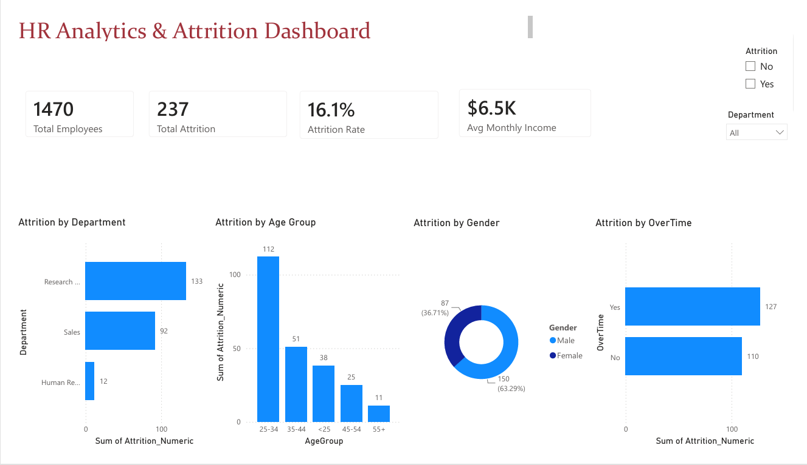
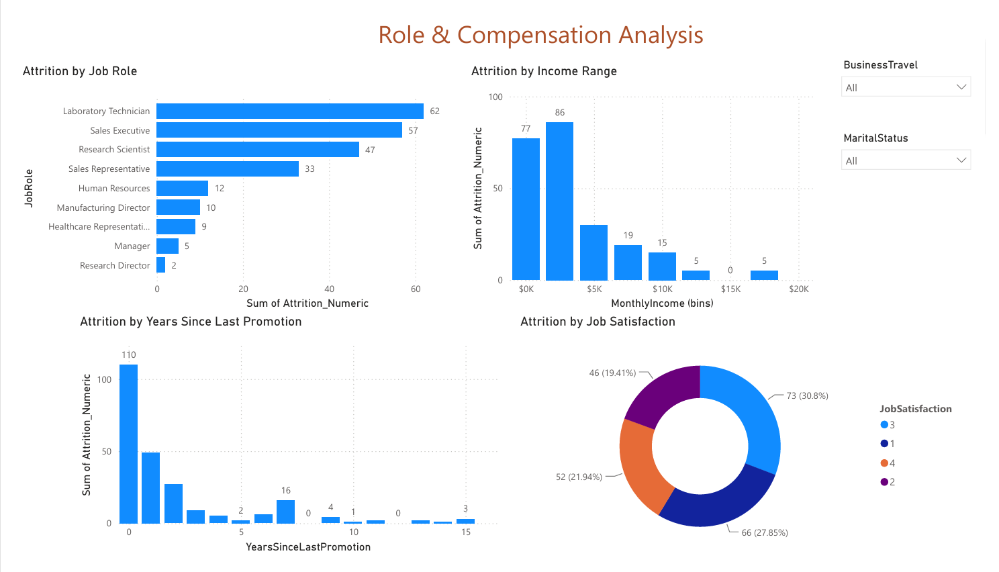

# 📊 HR Analytics & Attrition Intelligence Dashboard

An interactive, multi-page Power BI dashboard analyzing employee attrition across **1,470 employees**, uncovering demographic, compensation, and operational drivers behind workforce turnover to support proactive retention strategies.

---

## 🖼️ Dashboard Previews

### Page 1: Executive Overview & Demographics

### Page 2: Role & Compensation Analysis

---

## 📌 Executive Summary & Key KPIs

* **Total Employees:** 1,470
* **Total Attrition:** 237 employees
* **Overall Attrition Rate:** 16.1%
* **Average Monthly Income:** $6,500

---

## 💡 Key Analytical Findings

* **Department Analysis:** Research & Development accounts for the highest departure volume (133 exits), followed by Sales (92 exits) and Human Resources (12 exits).
* **Demographic Breakdown:** Peak turnover occurs within the 25–34 age bracket (112 employees), followed by entry-level staff under 25 (38 employees).
* **Workload & Burnout:** Overtime work shows a strong correlation with departures, accounting for 127 attrition cases compared to 110 for non-overtime staff.
* **Role-Specific Flight Risk:** Departures heavily impact Laboratory Technicians (62), Sales Executives (57), and Research Scientists (47).
* **Compensation Sensitivity:** Turnover clusters sharply in entry/mid salary bands under $5,000/month and drops substantially at higher income levels.
* **Promotion & Transition Friction:** The highest churn occurs within 0–1 years post-promotion or upon joining, pointing to early onboarding and transition challenges.

---

## 🛠️ Tools & Technologies Used

* **Business Intelligence:** Microsoft Power BI Desktop
* **Data Modeling & Transformation:** Power Query, Custom DAX Measures, Numerical Binning
* **Visualization Layer:** Clustered Bar/Column Charts, Donut Charts, Dynamic Dropdown Slicers, KPI Cards

---

## 🚀 How to View & Explore

1. Download the `HR_Analytics_Dashboard.pbix` file directly from this repository.
2. Open the file using [Microsoft Power BI Desktop](https://powerbi.microsoft.com/desktop/).
